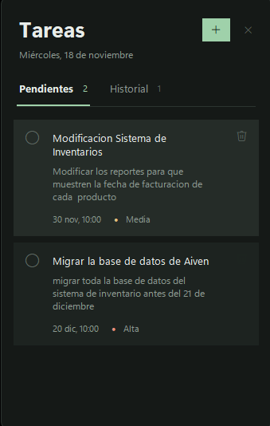
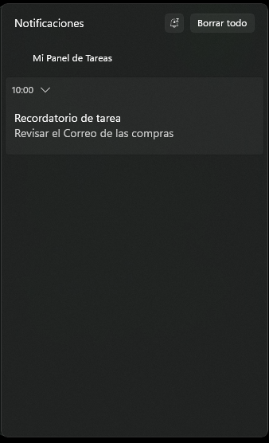

# Mi Panel de Tareas

Un widget de tareas minimalista para el escritorio de Windows 11, hecho con Python y Tkinter.

Vive pegado al escritorio: no tapa tus ventanas, sigue visible con **Win+D** y no ocupa espacio en la barra de tareas.

<p align="center">
  
  &nbsp;&nbsp;
  
</p>
<p align="center"><em>El widget en el escritorio · Un recordatorio en el centro de notificaciones</em></p>

## Características

- **Fijado al escritorio.** Se queda detrás de las demás ventanas y no desaparece con "Mostrar escritorio".
- **Icono en la bandeja del sistema.** Clic para mostrar u ocultar; clic derecho para salir.
- **Recordatorios.** Notificaciones nativas de Windows cuando llega la hora de una tarea.
- **Prioridades.** Alta, Media y Baja, con un punto de color en cada tarea.
- **Fechas legibles.** "Hoy, 14:30", "Mañana, 09:00"; las tareas vencidas se marcan en rojo.
- **Historial.** Las tareas completadas pasan al historial y se pueden restaurar.
- **Diseño Windows 11.** Esquinas redondeadas, tipografía Segoe UI Variable e iconos Fluent.
- **Recuerda su posición.** Arrástralo desde el encabezado y aparecerá ahí la próxima vez.
- **Datos locales.** Todo se guarda en un archivo SQLite (`tareas.db`) junto al programa.

## Requisitos

- Windows 11 (en Windows 10 funciona, pero sin esquinas redondeadas ni algunos iconos)
- Python 3.10 o superior, desde [python.org](https://www.python.org)

## Instalación

```powershell
git clone https://github.com/isaiasmed07/MiPanelTareas.git
cd MiPanelTareas
pip install -r requirements.txt
```

## Uso

Para abrirlo sin ventana de consola:

```powershell
pythonw tareas.py
```

- **+** abre el formulario de nueva tarea (**Enter** guarda, **Esc** cancela).
- **El círculo** de cada tarea la marca como completada.
- **El ícono de papelera** aparece al pasar el ratón; pide un segundo clic para confirmar.
- **La ×** oculta el widget; vuelve a mostrarlo desde el icono de la bandeja.

### Arrancar con Windows

```powershell
powershell -ExecutionPolicy Bypass -File instalar_inicio.ps1
```

Esto crea un acceso directo en la carpeta de Inicio. Para quitarlo, pulsa **Win+R**, escribe `shell:startup` y borra **Mi Panel de Tareas**.

## Probar las notificaciones

```powershell
python prueba_notificacion.py
```

Si no ves la notificación, revisa que las notificaciones estén activadas en *Configuración → Sistema → Notificaciones*.

## Licencia

[MIT](LICENSE)
